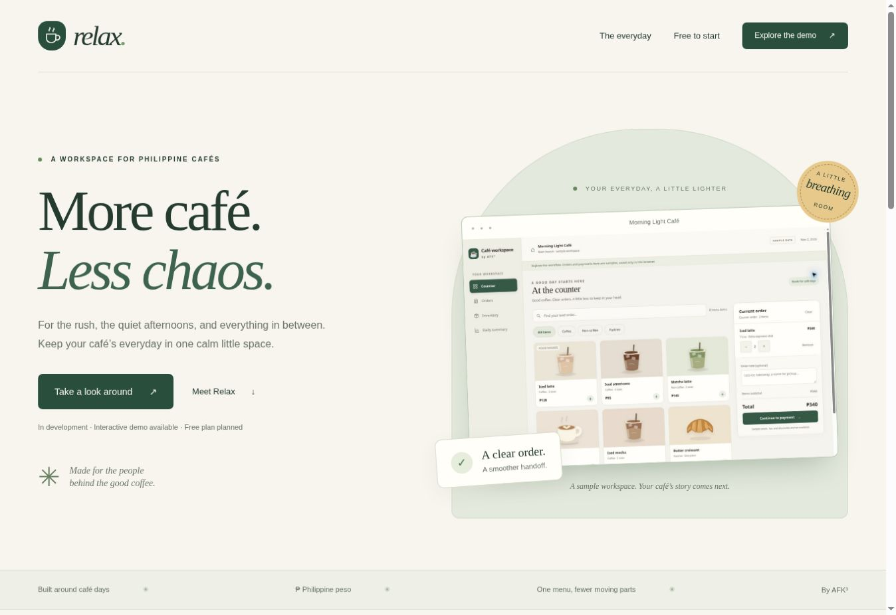

# Relax · Café POS by AFK³

A hosted café workspace for small Philippine cafés, with a warm green identity.

**Stage: public website, tenant foundation and interactive counter demo.** Tenant administration, owner sign-in, café profile/menu setup and menu-page publishing are implemented. The counter still uses browser-local sample data and is **not connected to tenant menus or databases**. Real payments, invoices, operational stock/recipes, employee management, AI, billing and reliable offline synchronization remain to build. Prices remain deferred.

**Release priority: finish the free tier first.** The [free release plan](docs/FREE-RELEASE.md) tracks the full target feature list and current gaps. Paid features appear as WIP previews on the site and café workspace; paid implementation, billing and the trial follow the usable free release.



## Routes

| Path on `relax.afkcube.com` | Purpose |
| --- | --- |
| `/` | Public Relax product website |
| `/{cafe-slug}` | Published café menu page, requiring active tenant and paid website access |
| `/{cafe-slug}/_app` | Café owner login and setup workspace |
| `/_console` | Protected Relax operator console |
| `/_demo/` | Sample-data counter/order/inventory/summary demo |
| `/api/health` | Railway readiness check |

There is no fallback/default tenant. Unknown, suspended and unpublished café pages return 404. Slugs are reserved and validated; database filenames use immutable server-generated business IDs. Keep sample tenants out of production.

## Run locally

Requires Node.js 24. There are no third-party runtime dependencies. See `.env.example`; export variables in your shell or use your environment's secret manager. No default console password is shipped.

```sh
npm run dev
npm run check
npm test
```

The public site/demo run locally without console credentials. Set `CONSOLE_USERNAME` and a unique `CONSOLE_PASSWORD` of at least 16 characters to initialize the operator. Development data defaults to `./data`, ignored by Git. Production requires persistent `DATA_DIR`, an HTTPS `PUBLIC_ORIGIN`, and console credentials.

## Implemented

- Responsive green product website and the existing counter demo.
- Separate operator/owner authentication, scrypt password hashes, hashed session tokens, HttpOnly sessions, origin/CSRF checks and sign-in throttling.
- Operator console: create tenant, main branch and owner; monitor usage; assign development entitlements; publish/unpublish websites; suspend/reactivate access; view recent audit events.
- Café workspace: save public profile; create/archive/restore menu items; create locations within granted allowances. One owner can belong to multiple locations.
- Server-enforced free allowance: one location and 20 active base menu items. Paid website publishing is gated. Paid allowances are explicit development grants, not finalized commercial packages or subscriptions.
- Platform SQLite database plus one database per business on a Railway volume. Versioned transactional startup migrations, pre-upgrade snapshots and manual backups.
- Automated checks cover counter rules and backend integration, including isolation, persistence, entitlement boundaries and migration recovery.

## Deploy and operate

See [Railway deployment and access](docs/DEPLOYMENT.md). `railway.json` selects Railpack, `npm start`, `/api/health` and one replica. Migrations run on startup **after the volume is mounted**, before readiness. Do not move SQLite migrations into a Railway pre-deploy container.

OTOM was reviewed for its separate platform database, database-per-tenant, provisioning, migration and operator-login patterns. Relax uses original code and path-based café URLs, not copied OTOM modules, data or secrets.

## Project documents

| Document | Purpose |
| --- | --- |
| [Free release](docs/FREE-RELEASE.md) | Free feature list, WIP boundary and release criteria |
| [Checklist](docs/CHECKLIST.md) | Completed work and remaining gates |
| [Deployment](docs/DEPLOYMENT.md) | Railway, domain, access and recovery |
| [Product scope](docs/PRODUCT-SCOPE.md) | Confirmed scope and deferred decisions |
| [Workflows](docs/WORKFLOWS.md) | Owner, counter, website, offline and trial journeys |
| [Screens](docs/SCREENS.md) | Proposed navigation |
| [Architecture](docs/ARCHITECTURE.md) | Implemented foundation and operational boundaries |
| [Validation guide](docs/VALIDATION.md) | Café-owner review and pilot gates |

Next: finish free onboarding/catalogue options and connect the counter to authenticated, branch-scoped transactions, with recipes, stock movements, payment/refund records and retry-safe operation IDs. Keep the demo separate until that work is complete. Paid offline synchronization is a later milestone, not a prerequisite for the free pilot.
