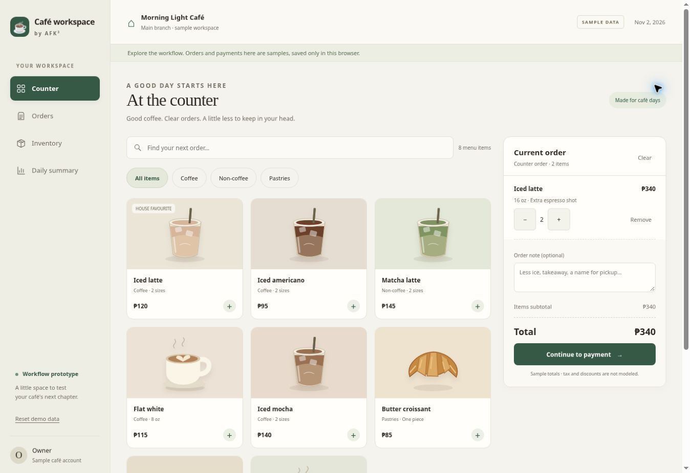

# AFK³ Café POS

A hosted POS service being designed for small Philippine cafés. Product name is provisional.

**Stage: workflow specification and interactive prototype.** This repository does not yet contain a production SaaS, real payment processing, fiscal invoicing, authentication, a cloud database, AI integration, or reliable offline synchronization. Prices are deliberately deferred.



## Review the prototype

Requires Node.js 22 or later. No dependency installation or API keys are needed.

```sh
npm run dev
```

Open the printed URL. Use the seeded café menu, add a drink with a size and extra shot, record a sample cash payment, prepare the order, and inspect stock and the daily summary. You can also try pending electronic payment, cancellation and a prepared-order refund.

All transactions are **sample records in this browser**. Use one tab. Reset demo data from the sidebar. Browser persistence is not the planned paid offline feature. Do not enter real customer information or use this prototype for trading.

```sh
npm test
npm run check
```

## Project documents

| Document | Purpose |
| --- | --- |
| [Checklist](docs/CHECKLIST.md) | Completed work, remaining decisions and implementation gates |
| [Product scope](docs/PRODUCT-SCOPE.md) | Confirmed scope, proposed details, deferred features and pricing status |
| [Workflows](docs/WORKFLOWS.md) | Owner, counter, customer, offline and assistant journeys with exceptions |
| [Screens](docs/SCREENS.md) | Proposed navigation and screen-to-workflow mapping |
| [Architecture](docs/ARCHITECTURE.md) | Business/branch boundaries, transaction lifecycle and future SaaS foundation |
| [Validation guide](docs/VALIDATION.md) | Café-owner review tasks and pilot acceptance checks |

## What is implemented

- Responsive café-style counter, order list/detail, ingredient stock and daily summary.
- Product search/category filters, sizes, extra shots, cart quantities and order notes.
- Sample cash checkout with change, and explicitly simulated electronic-payment confirmation.
- Separate payment and fulfillment status, guarded cancellation and full refunds.
- Recipe snapshots and ingredient consumption when preparation starts, as a **proposal for review**.
- Browser storage with visible save errors and no reported success on a failed write.
- Automated domain tests for payment, transition, stock, refund and daily-summary behavior.

## What comes next

Review the workflow proposal with café owners and resolve the open decisions in the checklist. Then implement the multi-business backend, staff/branch authorization, durable transaction handling and the first operational pilot. Design paid offline operation and entitlements with that foundation; do not treat this prototype's local storage as production architecture.

Railway is the intended hosting direction for the actual service. No service has been provisioned or deployed by this commit. The previous [POS desktop repository](https://github.com/Endercraft2017/POS-desktop-app) is a reference only; no legacy authentication, SQL bridge or Messenger scraping has been copied.
